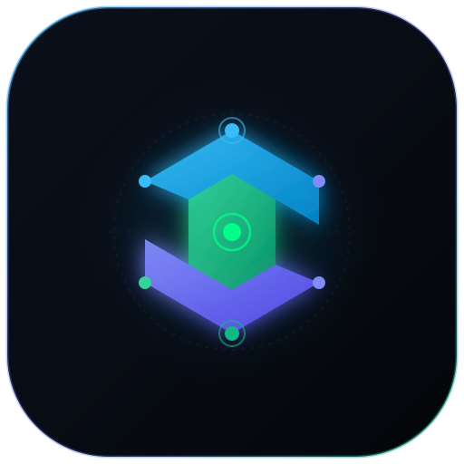
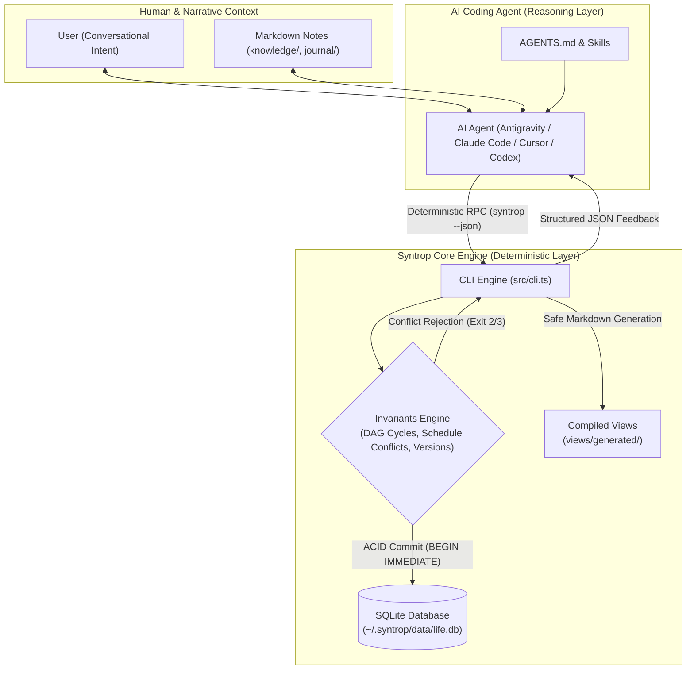

<div align="center">
  
  <h1>SYNTROP</h1>
  <p><strong>The Deterministic Operations Kernel for AI Coding Agents</strong></p>
  <p><em>A local-first SQLite operations engine with evidence-aware agent workflows, task dependencies, and conflict-checked schedules.</em></p>

  <p>
    <a href="https://github.com/ryanakml/syntrop/actions"></a>
    <a href="https://nodejs.org/"></a>
    <a href="package.json"></a>
    <a href="docs/architecture.md"></a>
    <a href="LICENSE"></a>
    <a href="CHANGELOG.md"></a>
  </p>

  <p>
    <a href="#the-problem-agent-amnesia--plan-rot"><b>The Problem</b></a> &nbsp;•&nbsp;
    <a href="#dual-layer-architecture"><b>Architecture</b></a> &nbsp;•&nbsp;
    <a href="#30-second-quick-start"><b>Quick Start</b></a> &nbsp;•&nbsp;
    <a href="#ai-agent-integration"><b>Agent Integration</b></a> &nbsp;•&nbsp;
    <a href="docs/cli-reference.md"><b>CLI Manual</b></a>
  </p>
</div>

---


## The Problem: Agent Amnesia & Plan Rot

AI coding agents can generate hundreds of lines of code in seconds, but they suffer from **context window amnesia**. 

When an agent context resets or compacts:
- It forgets prior execution history.
- It hallucinates uncompleted tasks as done.
- When tracked in flat `TODO.md` files, concurrent agents corrupt syntax, create circular dependencies, and clobber notes.
- Remote tools add network and account dependencies; some users prefer to keep operational records on local disk.

**Syntrop** (derived from *syntropy* — the creation of order out of chaos) provides a durable operational foundation for this workflow. It is a zero-dependency, local-first personal operations engine that equips AI coding agents and human builders with **deterministic operational state**: topological DAG task graphs, conflict-checked calendar intervals, optimistic concurrency locking, and immutable decision logs.

---

## Dual-Layer Architecture

Syntrop separates **cognitive reasoning** from **deterministic state mutations**:



---

## Architectural Invariants

* 🛡️ **Zero Runtime Dependencies**: Built exclusively on native Node.js 24 core modules (`node:sqlite`, `node:crypto`, `node:fs`, `node:path`). No runtime npm installation, `node-gyp`, or Python toolchain is needed.
* 🔒 **Local CLI Boundary**: Core commands work offline and never invoke LLMs. Explicit `integration google` network operations are optional and require separate consent. The active agent may also use external tools according to its runtime settings.
* 🕸️ **Topological DAG Dependencies**: Tasks form a Directed Acyclic Graph. Cycles are rejected at commit time. `syntrop task next` returns one ready action whose prerequisites are finished.
* ⏱️ **Conflict-Checked Half-Open Schedules**: Active work sessions and calendar events enforce half-open intervals `[start, end)`. Overlaps are rejected inside the transaction.
* 🔄 **Optimistic Locking & Idempotency**: Guard concurrent agent updates with `--expected-version N` and retry safely using `--idempotency-key KEY`.
* 🛡️ **Physical Workspace Sovereignty**: Code resides in the public repository; private data lives in `~/.syntrop`. The engine refuses workspace initialization inside the source checkout.
* 📄 **Non-Destructive View Generation**: Daily/weekly agendas compile strictly to `views/generated/`. Human narrative Markdown in `knowledge/` and `journal/` is never overwritten.

---

## 30-Second Quick Start

### 1. Prerequisites
Syntrop requires **Node.js >= 24.15.0 < 25** (Node 24 LTS):
```sh
node -v   # Must be >= 24.15.0
```

### 2. Setup
```sh
git clone https://github.com/ryanakml/syntrop.git
cd syntrop
chmod +x src/cli.ts
npm link   # Exposes `syntrop` (and alias `syn`) globally
```

### 3. Initialize Workspace
```sh
# Auto-detects your local system timezone and creates ~/.syntrop
syntrop init

# Verify workspace health
syntrop doctor
```

### 4. Core Workflow in 4 Commands
```sh
# Add a project and dependent tasks
syntrop project add --title "Launch Open-Source Project"
syntrop task add --title "Audit security and licensing" --status todo
# Output prints Task 1 ID (e.g. tsk_1234...). Use it as a prerequisite for Task 2:
syntrop task add --title "Publish release candidate" --status todo --depends-on <TASK_1_ID>

# Query only actionable, unblocked tasks (Task 2 is blocked, so only Task 1 appears!)
syntrop task next

# Mark task 1 completed (Task 2 will now automatically unblock and appear in `task next`!)
syntrop task done <TASK_1_ID>
```

*(Note: `syn` and `life` are also provided as CLI aliases for `syntrop`!)*

---

## Optional Google Calendar projection

View approved local schedules in **Syntrop · Focus** and selected reminders in **Syntrop · Habits**, using Google Calendar on web/mobile or the same Google account in Notion Calendar. Sync is manual and one way; Syntrop remains authoritative. Work sessions are timed busy events, optional deadlines are free all-day markers, and flexible habits never invent a clock time. Task notes and knowledge files stay local; titles are redacted by default.

```sh
syntrop integration google setup
syntrop integration google setup --client /absolute/path/desktop-client.json
syntrop integration google connect
syntrop --json integration google preview --from 2026-10-19 --through 2026-10-25
# Review the actual plan, replace PLAN_HASH with its approval value:
syntrop integration google sync --from 2026-10-19 --through 2026-10-25 --approve PLAN_HASH
```

Replace the dates with your intended window. OAuth uses your own Google Cloud Desktop client and system-browser consent; connecting alone uploads no schedule. Each sync requires a fresh approved preview. External edits become conflicts, and only workspace-owned projections are changed. Credentials live outside operational workspace backups. Core commands still work without Google.

**Beta evidence boundary:** mapping, mocked-client, fake-provider, and simulated CLI tests do not establish live Google authorization or a rendered calendar. Live OAuth, real API smoke, and Google/Notion visual QA have **not been completed** because an account-owner client and consent are unavailable. See the [setup guide](docs/integrations/google-calendar.md), [design decision](docs/calendar-design.md), and [validation report](evals/calendar-2026-10-17.md). No direct Notion API or automatic habit completion is claimed.

---

## Interactive Demonstrations

Experience DAG task resolution, schedule conflict rejection, and decision recording in an isolated sandbox:

```sh
# Run the interactive automated walkthrough (creates and cleans up a temporary sandbox)
./examples/tour.sh

# Or run the programmatic JavaScript verification demo
node examples/demo.mjs
```

---

## AI Agent Integration

[AGENTS.md](AGENTS.md) is the canonical cognitive protocol. Each independent intent takes the minimum sufficient path: a clear authorized action proceeds directly; a consequential plan waits for decision-changing evidence and unresolved choices. Research and reasoning feed planning only when needed. Readiness labels (`READY`, `NEEDS_EVIDENCE`, `NEEDS_DECISION`, `NEEDS_AUTHORIZATION`, `BLOCKED`) guide the agent; they are not new database statuses.

Thin adapters point each runtime to that protocol:

* **Claude Code**: [CLAUDE.md](CLAUDE.md).
* **Cursor**: [.cursor/rules/syntrop.mdc](.cursor/rules/syntrop.mdc).
* **GitHub Copilot**: [.github/copilot-instructions.md](.github/copilot-instructions.md).
* **Gemini CLI**: [GEMINI.md](GEMINI.md), its default context filename.
* **Codex**: [AGENTS.md](AGENTS.md).
* **Other runtimes, including Antigravity**: explicitly ask the agent to read `AGENTS.md`; automatic discovery is unverified.

The six [skills](skills/) provide focused workflows and are read as needed through `AGENTS.md`. They do not install themselves or create subagents. See the [integration guide](docs/agent-integration.md) for documented discovery mechanisms and runtime verification limits.

### Prompt Your Agent
Open your agent inside this repository and paste:
> *"You are my operations partner using Syntrop. Read `AGENTS.md` and run `syntrop doctor --json` to inspect our workspace. Inspect relevant goals, projects, tasks, and calendar commitments before recommending today's focus. Do not commit database mutations until authorized."*

For detailed setup, see the [Agent Integration Guide](docs/agent-integration.md).

---

## CLI Overview

| Category | Commands |
| :--- | :--- |
| **Workspace** | `syntrop init`, `syntrop doctor`, `syntrop validate`, `syntrop backup`, `syntrop restore`, `syntrop export` |
| **Goals & Projects** | `syntrop goal add\|list\|show\|update`, `syntrop project add\|list\|show\|update` |
| **Tasks & DAGs** | `syntrop task add\|list\|next\|show\|update\|done\|cancel`, `syntrop task depends add\|remove` |
| **Sessions & Calendar** | `syntrop schedule add\|list\|move\|cancel\|record`, `syntrop calendar add\|list\|move\|cancel` |
| **Habits** | `syntrop habit add\|list\|show\|update\|log\|history` |
| **Decisions** | `syntrop decision add\|list\|show` |
| **Optional Google Calendar** | `syntrop integration google setup\|connect\|status\|configure\|habit\|preview\|sync\|calendars\|colors\|availability\|recover\|disconnect` |
| **Views & Reviews** | `syntrop today`, `syntrop tomorrow`, `syntrop week`, `syntrop review week` |

*All commands support `--json` for structured output and exit codes `0` (ok), `2` (validation), `3` (conflict), and `4` (workspace).*  
For full syntax, see the [CLI Reference](docs/cli-reference.md).

---

## Documentation

- [Getting Started Guide](docs/getting-started.md) — Comprehensive first-run onboarding walkthrough.
- [CLI Reference](docs/cli-reference.md) — Complete command flags, options, exit codes, and JSON schemas.
- [Architecture & Invariants](docs/architecture.md) — Invariant specifications, migrations, and concurrency model.
- [Agent Integration Guide](docs/agent-integration.md) — Multi-agent setup, prompt patterns, and skills catalog.
- [Google Calendar Setup](docs/integrations/google-calendar.md) — Desktop OAuth, preview, sync, privacy, and Notion Calendar viewing.
- [Calendar Architecture](docs/calendar-design.md) — Scope decisions, ownership, reconciliation, and live verification limits.
- [Behavior Evaluation Guide](evals/README.md) — Scenario fixtures, scoring, and limits of behavioral evidence.
- [Contributing Guidelines](CONTRIBUTING.md) — Development environment, testing, and pull request process.
- [Security Policy](SECURITY.md) — Responsible disclosure and threat model.

---

## Current Status & Limitations

Syntrop is currently in **Beta (v0.3.0)**.
- **Local-First & Single-User**: Designed for single-user local disk operations. Multi-device sync is handled via external backup or personal git repositories.
- **Node 24 Requirement**: Leverages `node:sqlite` and native TypeScript type stripping; requires Node.js >= 24.15.0 < 25.
- **Manual Calendar Integration**: Google projection is optional; no bidirectional import or continuous sync. Browser consent and actual remote/UI behavior remain unverified live.
- **No Autonomous Daemon**: Syntrop does not run background services or send push notifications. Review and replanning occur when initiated by the user or agent.
- **Agent-Guided Judgment**: Evidence checks and planning readiness are instructions for the active agent, not engine guarantees. The CLI can reserve future sessions for dependency-blocked tasks; the agent must check readiness and prerequisite timing before proposing a session.
- **Evaluation Boundaries**: Engine tests verify deterministic behavior. Scenario fixtures and instruction checks do not prove reliable behavior across models or runtimes; see [evals](evals/README.md).
- **Zero Built-in LLM Dependencies**: Syntrop does not bundle proprietary LLM tokens or API keys. Reasoning is driven by the user's active AI agent runtime.

---

## License

This project is licensed under the [MIT License](LICENSE).  
Copyright (c) 2026 Syntrop contributors.
