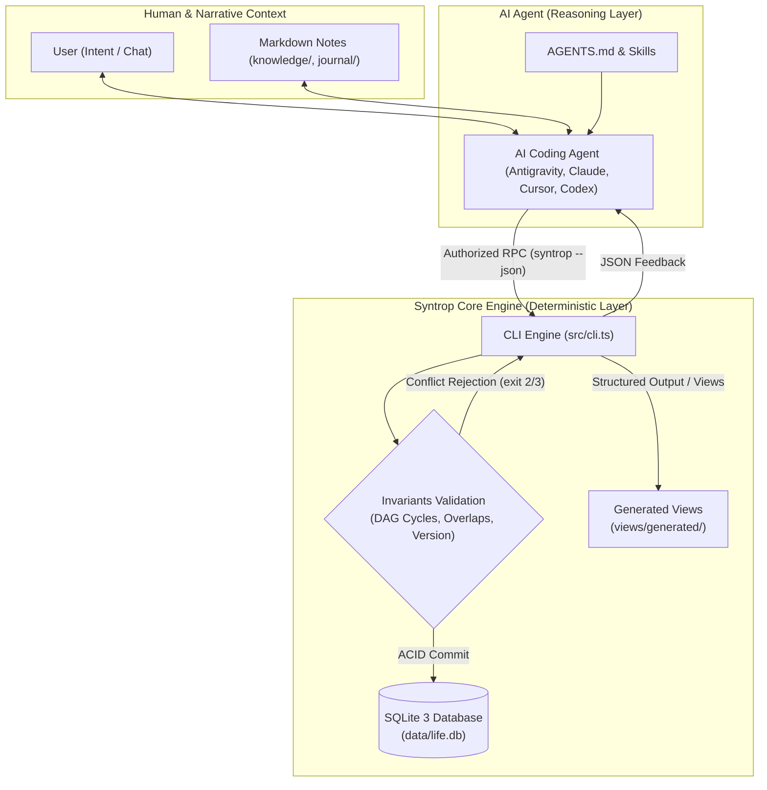

# Architecture and Data Contract

Syntrop is a local-first operations engine that gives AI coding agents persistent operational state and deterministic tools. The active runtime supplies judgment; it may use network services. Core CLI operations remain offline; explicit optional Google integration commands have a separate network and authorization boundary.

---

## 1. Dual-Layer Architecture

Syntrop enforces a strict architectural boundary between **deterministic operational state** and **cognitive narrative context**:



### Authorities and Boundaries
- **Operational Authority (SQLite)**: Tasks, goals, projects, work sessions, calendar events, habits, and decisions are stored exclusively in SQLite (`data/life.db`). SQLite enforces foreign keys, unique occurrence constraints, version numbers, and index integrity.
- **Narrative Authority (Markdown)**: Free-form user thinking, observation logs, meeting transcripts, and energy preferences live in `knowledge/` and `journal/`.
- **Deterministic Write Boundary (The CLI)**: Core operations make no network requests and do not invoke LLMs or background daemons. Explicit Google integration commands can authorize, read, or publish a calendar projection; they do not change the core scheduling authority.
- **Non-Destructive View Generation**: Machine-compiled views write strictly to `views/generated/`. User-written notes elsewhere are never overwritten.

### Cognitive orchestration (v0.2.0)

[AGENTS.md](../AGENTS.md) is the canonical routing contract; thin runtime adapters point to it. Six existing skills provide specialist processes. Each independent intent gets a minimum sufficient path:

```text
User intent → readiness assessment
  clear + authorized → direct action
  material unknowns → inspect evidence → compare/recommend as needed
  user-owned choice or missing authorization → concrete proposal → user decision
  sufficiently mature plan → task decomposition → scheduling when requested
Authorized CLI write → validate → read back → report → adapt when needed
```

`READY`, `NEEDS_EVIDENCE`, `NEEDS_DECISION`, `NEEDS_AUTHORIZATION`, and `BLOCKED` are cognitive classifications. They add no columns, migrations, CLI commands, or task statuses. Research and reasoning are conditional inputs to planning, not mandatory stages for every request. The agent inspects decision-changing ground truth before consequential planning and stops research when more evidence is unlikely to change the immediate decision.

Instructions can guide model behavior but cannot enforce sound reasoning, guarantee consent recognition, or prove fresh-agent continuity. The CLI enforces its supported data invariants regardless of those cognitive judgments. [Behavior evaluations](../evals/README.md) therefore distinguish deterministic checks from observed agent behavior.

### Scheduling readiness boundary

Task `ready` reflects operational task/project state and prerequisites. Cognitive readiness describes whether an intent has enough evidence, decisions, and authorization; it is a separate concept. `task next` returns one ready task, not the entire ready queue.

The scheduling engine permits reserving a future session for a task whose dependencies are unfinished. It rejects overlapping intervals and terminal/inactive targets, but does not prove the task will be ready by the session start. The agent must inspect prerequisites, estimates, existing commitments, and capacity before recommending time. Calendar availability is an upper bound, not proof of feasible execution.

---

## 2. Architectural Invariants

| Invariant | Enforcement Mechanism | Failure Mode |
| :--- | :--- | :--- |
| **Topological DAG Integrity** | Pre-commit cycle detection in SQLite `BEGIN IMMEDIATE` transaction. | Exit `3` (Conflict): Circular dependency rejected. |
| **Prerequisite Completion** | `task done` verifies all prerequisite tasks are completed (`done`). | Exit `3` (Conflict): Unfinished prerequisites. Override requires `--allow-blocked --reason TEXT`. |
| **Project Completion Guard** | `project update ID --status done` verifies all linked tasks are `done` or `cancelled`. | Exit `3` (Conflict): Open tasks remain. Override requires `--allow-open-tasks --reason TEXT`. |
| **Temporal Conflict Rejection** | Half-open intervals `[start, end)` checked across active sessions and events. | Exit `3` (Conflict): Overlapping schedule interval. |
| **Optimistic Concurrency** | When `--expected-version N` is supplied, it must match the record version. The agent protocol requires it for supported updates to previously read records. | Exit `3` (Conflict): Stale record version. |
| **Idempotency Guarantee** | Request fingerprint and cached response stored in `idempotency_keys` table. | Replay returns identical response; reusing key with different payload returns exit `3`. |
| **Physical Isolation** | `assertOutsideSource(path)` checks realpath of workspace against source root. | Exit `2` (Validation): Cannot initialize private data inside repository checkout. |

---

## 3. Schema Migrations

- **Migration 1**: Initial schema (goals, projects, tasks, task_dependencies, work_sessions, calendar_events, habits, habit_occurrences, decisions, idempotency_keys).
- **Migration 2**: Task/project completion override reasons and calendar event status.
- **Migration 3**: `session_outcomes` for observed work sessions (`actual_minutes`, `note`, `outcome`).

### Safe Vacuum Migrations
When migrating from earlier schema versions, Syntrop automatically invokes SQLite `VACUUM INTO` to create a verified snapshot in `data/migration-backups/` before applying schema migrations.

---

## 4. Backup & Recovery Contract

- **`syntrop backup --to DIRECTORY`**:
  Uses Node 24 native SQLite `backup` API to produce a clean, transactionally consistent snapshot of `data/life.db`, copying non-database files recursively. Never performs raw file copies on live WAL databases.
- **`syntrop restore --from DIRECTORY --workspace NEW_PATH`**:
  Inspects SQLite integrity (`PRAGMA integrity_check`), verifies schema version, and provisions a fresh workspace. Refuses to overwrite existing files.


## 5. Optional calendar projection (v0.3.0 beta)

`src/google-cli.ts` isolates opt-in commands from core operations. `google-projection.ts` maps a read-only operational snapshot; `google-auth.ts` handles Desktop PKCE consent and restricted secret files; `google-client.ts` provides bounded API calls; `google-sync.ts` reconciles workspace-owned events. No core schema migration or mandatory hosted service is introduced.

Google is a visual projection, not operational authority. Dedicated Focus and Habits calendars are created only when an approved plan needs them. Each authenticated preview reads current Google state, returns an approval hash, and makes no local-file or remote-calendar writes. Sync rechecks the hash, applies conditional writes, and reads back results. Changed owned events use full event replacement (`PUT`) with ETag `If-Match`, avoiding stale omitted fields from patch semantics. Cross-service operations are not atomic; partial failures require a new preview. External edits/deletions become conflicts, recurring exceptions require manual resolution, and unrelated events are never matched by title.

OAuth configuration, credentials, calendar IDs, mappings, and projection preferences live outside the operational workspace under `~/.syntrop-google/<workspace-path-hash>/`. Ordinary backups intentionally omit them. A restored workspace at another path does not silently acquire remote-write access. Default disconnect removes tokens; optional revocation is distinct and can fail remotely. Neither deletes calendars or operational records.

See [calendar design and primary-source research](calendar-design.md) for least-privilege scopes, lifecycle policies, colors, recurrence, backup risks, and recovery. [Onboarding](integrations/google-calendar.md) requires a user-owned Desktop client and consent. Unit/client/sync simulations are separate from live Google OAuth/API and visible Google/Notion verification; the latter remain uncompleted in this beta's initial implementation evidence.
