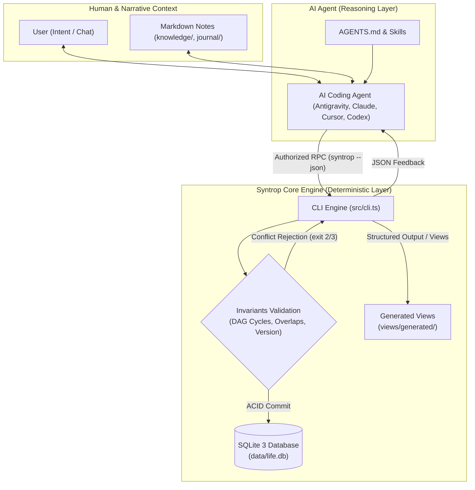

# Architecture and Data Contract

Syntrop is an air-gapped, local-first operations engine designed to provide AI coding agents with verifiable state memory and deterministic tools.

---

## 1. Dual-Layer Architecture

Syntrop enforces a strict architectural boundary between **deterministic operational state** and **cognitive narrative context**:

### Authorities and Boundaries
- **Operational Authority (SQLite)**: Tasks, goals, projects, work sessions, calendar events, habits, and decisions are stored exclusively in SQLite (`data/life.db`). SQLite enforces foreign keys, unique occurrence constraints, version numbers, and index integrity.
- **Narrative Authority (Markdown)**: Free-form user thinking, observation logs, meeting transcripts, and energy preferences live in `knowledge/` and `journal/`.
- **Deterministic Write Boundary (The CLI)**: The CLI does **not** call LLMs, make network requests, or run background daemons. It is a deterministic state machine.
- **Non-Destructive View Generation**: Machine-compiled views write strictly to `views/generated/`. User-written notes elsewhere are never overwritten.

---

## 2. Architectural Invariants

| Invariant | Enforcement Mechanism | Failure Mode |
| :--- | :--- | :--- |
| **Topological DAG Integrity** | Pre-commit cycle detection in SQLite `BEGIN IMMEDIATE` transaction. | Exit `3` (Conflict): Circular dependency rejected. |
| **Prerequisite Completion** | `task done` verifies all prerequisite tasks are completed (`done`). | Exit `3` (Conflict): Unfinished prerequisites. Override requires `--allow-blocked --reason TEXT`. |
| **Project Completion Guard** | `project update ID --status done` verifies all linked tasks are `done` or `cancelled`. | Exit `3` (Conflict): Open tasks remain. Override requires `--allow-open-tasks --reason TEXT`. |
| **Temporal Conflict Rejection** | Half-open intervals `[start, end)` checked across active sessions and events. | Exit `3` (Conflict): Overlapping schedule interval. |
| **Optimistic Concurrency** | Record `version` must match `--expected-version N` on updates. | Exit `3` (Conflict): Stale record version. |
| **Idempotency Guarantee** | Request fingerprint and cached response stored in `idempotency_keys` table. | Replay returns identical response; reusing key with different payload returns exit `3`. |
| **Physical Isolation** | `assertOutsideSource(path)` checks realpath of workspace against source root. | Exit `2` (Validation): Cannot initialize private data inside repository checkout. |

---

## 3. Schema Migrations

- **Migration 1**: Initial schema (goals, projects, tasks, task_dependencies, work_sessions, calendar_events, habits, habit_occurrences, decisions, idempotency_keys).
- **Migration 2**: Task/project completion override reasons and calendar event status.
- **Migration 3**: `session_outcomes` for observed work sessions (`actual_minutes`, `note`, `outcome`).

### Safe Vacuum Migrations
When migrating from earlier schema versions, Syntrop automatically invokes SQLite `VACUUM INTO` to create a verified snapshot in `data/migration-backups/` before applying schema migrations.

---

## 4. Backup & Recovery Contract

- **`syntrop backup --to DIRECTORY`**:
  Uses Node 24 native SQLite `backup` API to produce a clean, transactionally consistent snapshot of `data/life.db`, copying non-database files recursively. Never performs raw file copies on live WAL databases.
- **`syntrop restore --from DIRECTORY --workspace NEW_PATH`**:
  Inspects SQLite integrity (`PRAGMA integrity_check`), verifies schema version, and provisions a fresh workspace. Refuses to overwrite existing files.
