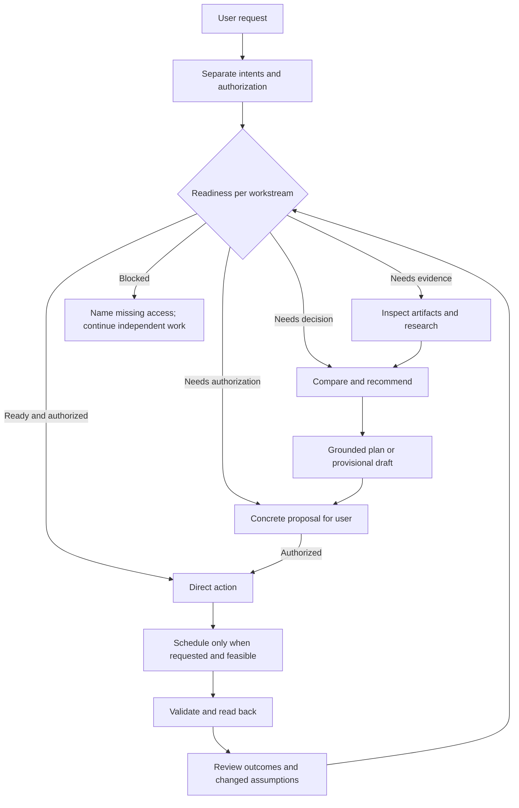

# Cognitive orchestration design — v0.2.0 beta

## Problem and decision

The v0.1.0 root guide already distinguished intent, research, and authorization. The gap was operational specificity: a flat skill menu, no per-workstream readiness gate, no concrete artifact reconnaissance condition, and no planning smell test. Planning could turn unresolved strategy into user homework; habits could pull unrelated ambitions into execution. This is an instruction-layer defect, not a reason to redesign SQLite.

Keep [AGENTS.md](../AGENTS.md) the concise canonical routing contract, six existing specialist skills as domain procedures, and thin runtime adapters as discovery pointers. No orchestration skill, persistent cognitive state, hosted service, or mandatory framework is added. Research and reasoning may compose before planning; reflection can route back upstream. The external agent owns tool use and judgment; the CLI owns deterministic records. Narrative Markdown remains private supporting context.

## Minimum sufficient routing

Arrows describe possible composition, not mandatory steps. A habit addition can finish directly. A discussion can end at a recommendation. A requested provisional plan can end as an uncommitted draft with assumptions. Readiness labels are cognitive categories, not SQLite enum values, and need not appear in every response.

Inspect a portfolio before asserting its defects; inspect contribution rules/issues before recommending OSS work; inspect an existing editor configuration when migration choices depend on it. Research stops when more evidence is unlikely to change the immediate decision. No access means an explicit unknown, not an invented observation.

“Choose a repo” is a smell when an agent could investigate now; it is not categorically an invalid task. Human interviews, requested timeboxes, and meaningful later checkpoints remain legitimate. Make current executable steps concrete, keep contingent future work provisional, and preserve user-owned choices. Recommendation, acceptance, permission to record, and execution permission are distinct. Existing permission covers routine execution details without repeated approval.

Optional specialist delegation uses bounded independent briefs with evidence requirements, tools, permissions, and stopping rules. Investigations do not mutate shared user state; the main agent resolves contradictions. Sequential operation remains complete. A skill file neither starts an agent nor grants permissions.

## Evidence and alternatives considered

Sources inspected on 2026-10-16; these are design influences, not imported third-party instructions:

- [Agent Skills specification](https://agentskills.io/specification): metadata, body, and supporting resources support progressive disclosure. Adaptation: concise discovery descriptions and focused six-skill composition, rather than another mandatory router skill.
- [Anthropic: Building effective agents](https://www.anthropic.com/engineering/building-effective-agents): simple composable routing, environment feedback, bounded orchestration. Adaptation: minimum sufficient process with optional independent investigations; reject a fixed waterfall for every request.
- [Anthropic: Demystifying evals for AI agents](https://www.anthropic.com/engineering/demystifying-evals-for-ai-agents): evaluate agent traces and final environment alongside responses. Adaptation: separate static contract checks, deterministic CLI regression, actual scenario traces, and fresh-context evidence.
- [obra/superpowers brainstorming skill](https://github.com/obra/superpowers/blob/main/skills/brainstorming/SKILL.md): investigation before implementation illustrates staged readiness. Adaptation: inspect material unknowns before consequential planning; reject a universal design-approval ceremony for trivial operational requests.

Research ended once the protocol ownership, ordering, permission boundaries, and evaluation strategy were settled; further framework comparisons would not change implementation.

## Validation and limits

See [evaluation procedure](../evals/README.md) for synthetic A–L requests, fixture creation, trace requirements, scoring, and observed results. Static checks validate discoverability and contract structure; CLI tests validate deterministic invariants. Neither proves LLM compliance. Actual behavior requires response/tool traces and read-back state; repeated trials across models and runtimes remain necessary before making broad reliability claims.

No CLI/schema behavior changes in this release. Cognitive readiness, authorization, estimates, and human capacity remain agent responsibilities. The CLI checks operational invariants such as overlap, cycles, versions when provided, and completion rules, but permits scheduling a blocked task for future work. A multi-command plan is not an atomic transaction; inspect partial success before retries. Workspace isolation protects local source checkouts, not against arbitrary tools copying private information. External agent privacy depends on its own configuration.
